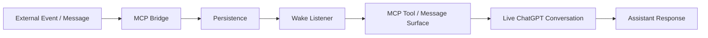

# Wake MCP Bridge

> An event-driven MCP integration prototype for receiving external events and waking a live AI conversation.

**Status:** End-to-end proof of concept validated  
**Test device:** iPhone 12  
**Focus:** MCP · Streamable HTTP · event-driven integration · persistence · runtime listeners · debugging

---

## Why This Exists

Most chat systems are reactive: the user opens the app and sends a message first.

This project explored a different question:

> **Can an external event be received, persisted and surfaced into a live AI conversation so the assistant can react without the user manually starting the interaction?**

The prototype was designed as a bridge between an external message source and a live ChatGPT conversation through MCP.

---

## Prototype Flow



The important part of the experiment was not only sending a message.

It was validating the full chain:

**external event → bridge → persistence → listener → live conversation → response**

---

## What Was Validated

| Capability | Status |
|---|---|
| MCP server starts locally | ✅ Working |
| Streamable HTTP transport | ✅ Working |
| ChatGPT tool discovery | ✅ Working |
| Developer Mode configuration | ✅ Working |
| External message persistence | ✅ Working |
| Listener detects new message | ✅ Working |
| Wake event reaches live conversation | ✅ Working |
| End-to-end test on iPhone 12 | ✅ Working |
| Always-on cloud deployment | ⚪ Not implemented |
| Production authentication / rate limiting | 🟡 Future hardening |
| Multi-device production validation | 🟡 Not yet claimed |

The project is presented as a **validated prototype**, not as a production notification service.

---

## Real Integration Debugging

The prototype required several integration layers to line up correctly:

- local MCP server
- Streamable HTTP transport
- ChatGPT Developer Mode
- tool discovery
- message persistence
- listener process
- mobile client behavior
- live conversation state

The working setup used:

- **iPhone 12** for the mobile ChatGPT client
- **Mac** for the local bridge / listener processes
- **two local terminal processes** during testing
- **Streamable HTTP** as the MCP transport

The project moved through a real debugging loop of:

```text
no visible reaction
→ inspect connection / tool state
→ verify transport and listener
→ confirm tool discovery
→ persist message
→ listener wakes
→ live conversation reacts
```

This is one of the most important parts of the case study: it demonstrates integration debugging rather than only diagramming a theoretical system.

---

## Architecture

### 1. MCP Bridge

Receives or exposes the message interface used by the external event source and ChatGPT.

### 2. Persistence

Stores the incoming event so delivery is not dependent on a single transient UI state.

### 3. Wake Listener

Observes persisted state and detects new events that should be surfaced.

### 4. MCP Tool Surface

Makes the event available through the connected MCP capability.

### 5. Live Conversation

The event becomes actionable inside the active AI conversation.

More detail: [Architecture](docs/ARCHITECTURE.md)

---

## Design Principles

### Persist before wake

An incoming event should exist independently of whether a UI is currently open.

### Separate transport from meaning

HTTP transport, MCP capability, persistence and conversation behavior are separate layers.

### Debug layer by layer

When the system does not react, verify:

1. server
2. transport
3. tool discovery
4. persistence
5. listener
6. client / conversation surface

### Prototype claims stay narrow

A successful device test proves the integration path.

It does not automatically prove:

- always-on reliability
- multi-device behavior
- production authentication
- high-volume delivery
- guaranteed notification semantics

More detail: [Design Decisions](docs/DESIGN_DECISIONS.md)

---

## Example Event Envelope

[Sanitized Event Example](examples/event-envelope.example.json)

The public example is synthetic and contains no private message content.

---

## My Role

I drive:

- problem framing
- integration architecture
- test setup
- MCP configuration
- debugging strategy
- end-to-end acceptance
- failure isolation
- documentation and portfolio evidence

I use AI extensively as an implementation partner for coding, debugging and iteration.

---

## Technologies & Concepts

**Integration**  
MCP · Streamable HTTP · APIs · event-driven architecture

**Runtime / Data**  
persistence · listener processes · routing · state boundaries

**Engineering**  
end-to-end testing · integration debugging · failure isolation · device validation

---

## Relationship to Home

Wake is a supporting integration project for:

[Home — Persistent Multi-Agent AI Workspace](https://github.com/echowang519/home-ai-workspace)

Home focuses on persistent AI workspace architecture.  
Wake focuses on **external events entering a live AI interaction loop**.

---

## What This Demonstrates

This project demonstrates the ability to:

- connect multiple system layers
- work with MCP and transport configuration
- reason about persistence versus transient UI state
- debug a real device integration
- validate an event-driven workflow end to end
- separate a successful prototype from unproven production claims

That makes it particularly relevant to **AI Implementation, AI Solutions and applied integration work**.
